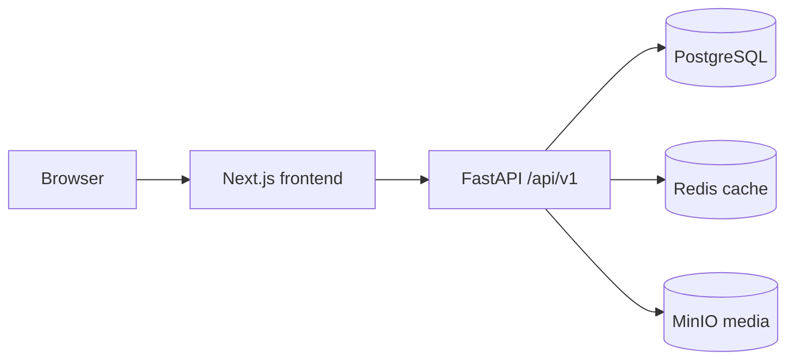
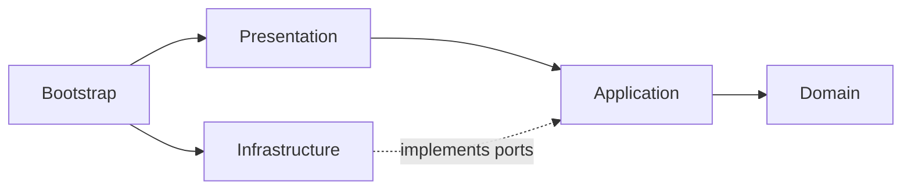

# Architecture

## Overview

The product is a modular monolith with a Next.js frontend and a FastAPI backend.
PostgreSQL is the source of truth. Redis is an optional performance adapter, and
MinIO provides S3-compatible object storage for development and small VPS deployments.

## Backend dependency rule

Dependencies point inward:

- `domain`: entities, value objects, enums, policies, and pure business rules.
- `application`: use cases, DTOs, repository/UoW/security/storage/cache ports.
- `infrastructure`: SQLAlchemy, PostgreSQL, Redis, S3, JWT, and password adapters.
- `presentation`: FastAPI routers, HTTP schemas, dependencies, and error mapping.
- `bootstrap`: the composition root and process lifecycle.

Domain objects are not SQLAlchemy models. Application code never imports concrete
infrastructure adapters. Routers validate and map HTTP data but do not implement business rules.

The project runtime is Python 3.12.x. Docker, `requires-python`, Ruff, mypy, and CI are kept on
that version so the supported language surface is unambiguous.

## Domain modules

- Users and authentication: identity, roles, refresh sessions, profile preferences.
- Courses: course, module, lesson, task, option, accepted answer, publishing policy.
- Learning: enrollment, attempts, task completion, progression policy, progress queries.
- Gamification: XP ledger, daily activity, streak calculation, leaderboards.
- Media: a deliberately thin metadata/reference module. `MediaAsset` may be used by domain and
  application code, while upload, download, deletion, object names, and MinIO/S3 details remain
  infrastructure behind `StoragePort`. Media has no independent workflow or business rules unless
  a later product requirement proves one is needed.

## Target data model

The initial business migration will introduce `users`, `refresh_sessions`, `courses`,
`course_modules`, `lessons`, `tasks`, `task_options`, `task_accepted_answers`,
`media_assets`, `course_enrollments`, `task_attempts`, `user_task_progress`,
`user_daily_activity`, and `xp_transactions`.

UUIDs are public identities. Persisted timestamps are timezone-aware UTC. Ordered content
uses an integer `position` plus scoped uniqueness constraints; position is never identity.

## Authentication flow

1. Registration always creates a `USER`; promotion to `TEACHER` is an offline management command.
2. Login returns a short-lived JWT access token and sets an opaque refresh token cookie.
3. The frontend keeps access tokens only in memory. The refresh cookie is HttpOnly.
4. Refresh rotates the session token transactionally; only a hash is stored in PostgreSQL.
5. The frontend uses a single-flight refresh promise and retries a failed request once.
6. Logout revokes the refresh session and expires the cookie.

Production uses `Secure`, `HttpOnly`, scoped `Path`, and configured `SameSite` cookie settings.
Refresh-token values are generated with `secrets`, stored only as HMAC-SHA256 digests, and rotated
inside a locked database transaction. Replaying a rotated token is rejected.

## Task evaluation and answer security

`SubmitTaskAttempt` dispatches to one of three deterministic evaluators:
`SINGLE_CHOICE`, `MULTIPLE_CHOICE`, or `TEXT_INPUT`. Text answers use Unicode normalization,
trimmed whitespace, and case-insensitive comparison against structured accepted answers.

Learner and teacher task read models are separate. Learner responses never contain option
correctness, accepted text answers, correct option IDs, or internal evaluation settings.
Correct-answer data may be returned only in post-submission feedback. API tests treat this
as a security invariant.

The task application module owns authoring validation, learner projections, evaluation dispatch, and
attempt recording. A pure domain evaluator compares choice sets exactly and normalizes text with NFKC,
whitespace collapse, and case folding. `task_attempts` is append-only history; it intentionally does
not award XP or mark progress until those phases introduce their own idempotent records.

## Progress, XP, and streak

- A unique `(user_id, task_id)` progress row records first correct completion.
- Lesson/module/course completion and percentages are initially calculated from required content.
- A successful first completion creates one append-only XP transaction. A unique source key
  prevents duplicate awards under retries and concurrent requests.
- Completing a lesson inserts daily activity keyed by `(user_id, local_date)`, where local date
  uses the user's IANA timezone. UTC timestamps remain authoritative.
- Weekly leaderboard boundaries use UTC. Redis may cache results; PostgreSQL remains authoritative.
- Sequential lesson unlock is an application policy, not frontend logic.

The MVP progress implementation persists only enrollment and first correct task completion. Lesson,
module, and course states are fixed-query projections over ordered content and `user_task_progress`,
avoiding stale aggregate flags and per-course query loops. A PostgreSQL uniqueness constraint on
`(user_id, task_id)` makes completion idempotent under retries and concurrent submissions.

### Read-model query policy

Catalog, profile, enrollment, and progress queries must be shaped as bounded read models. A list
of courses is loaded using a constant number of queries (join/select-in loading and grouped
aggregates where appropriate), never a per-course query loop. Repository/query tests will cover
the hot list endpoints as they are introduced, and SQLAlchemy relationship loading must be
explicit so N+1 regressions are visible in review.

## Published content policy

An `ARCHIVED` course cannot be started or enrolled in by new learners. Existing enrolled learners
retain read and learning access and can complete the course. Content that has learner progress
cannot be hard-deleted or structurally removed by its teacher; the teacher may make additive or
non-destructive copy changes only. Removing progressed content requires an explicit future
revision/soft-delete policy, while archiving remains the MVP way to retire a course.

## Course authoring boundary

Teacher endpoints are protected by both the `TEACHER` dependency and an application-level course
ownership check. Learner catalog queries filter to `PUBLISHED` status in SQL; a draft is not merely
hidden in the frontend. Course publish validation executes on the server and will expand from the
initial content-presence checks to type-specific task rules as task authoring endpoints are added.

## Media lifecycle

Uploads are validated by MIME type, extension, byte limit, and successful image decode before
storage under a random object key. PostgreSQL stores metadata and references. If metadata
persistence fails after a successful object upload, the application immediately deletes that new
object. Physical objects are otherwise never deleted while referenced; a future conservative
orphan-cleanup command may address failures outside that request lifecycle. MinIO uses an internal
endpoint for backend traffic and a separately configured public endpoint for browser-visible signed
download URLs.

## Frontend and API contract

FastAPI OpenAPI is exported to `openapi.json`; Orval generates Fetch functions, models, and
TanStack Query hooks in `frontend/src/shared/api/generated`. Generated files are never hand-edited.
Frontend code is organized by feature, with cross-cutting API/UI/config primitives under `shared`.
Visible Russian strings live in `frontend/messages/ru.json`. The temporary product name lives only
in `frontend/src/shared/config/site.ts`.

## Deployment topology

Development Compose exposes frontend, backend, PostgreSQL, Redis, MinIO API, and MinIO Console.
For a VPS, a reverse proxy terminates HTTPS and routes one public origin: `/` to Next.js and
`/api/` to FastAPI. Database, Redis, and MinIO stay private. No component requires Kubernetes,
Vercel, AWS-specific services, or a public MinIO endpoint.
